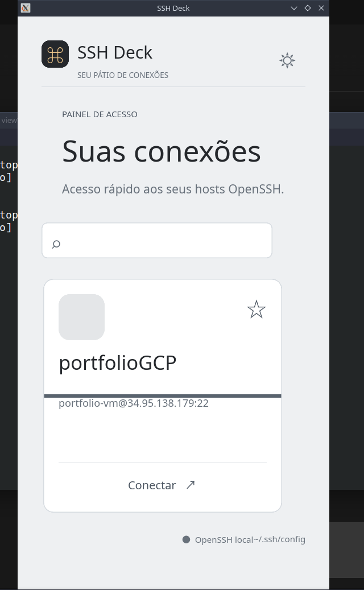

# nexSSH

Gerenciador visual de conexões SSH para Linux, com interface nativa em Qt e terminal integrado ao aplicativo.



## Recursos

- Leitura e gerenciamento de conexões do OpenSSH;
- criação, edição e exclusão de conexões;
- autenticação por chave privada ou login e senha;
- seletor de arquivo para chaves privadas;
- senhas mantidas somente em memória durante a execução;
- terminal SSH integrado com abas;
- duplo clique em uma conexão para abrir a sessão;
- ícones SVG coloridos para sistemas e provedores;
- seleção de SVG personalizado;
- backups automáticos do `~/.ssh/config` antes de alterações;
- interface escura, nativa e redimensionável.

## Tecnologias

- C++17;
- Qt 5 Widgets;
- QTermWidget;
- CMake;
- OpenSSH.

## Dependências

Em distribuições baseadas em Debian/Ubuntu:

```bash
sudo apt install build-essential cmake qtbase5-dev libqtermwidget5-0-dev
```

## Compilação e execução

```bash
cmake -S . -B build-qt
cmake --build build-qt -j2
./build-qt/nexssh
```

O aplicativo utiliza e modifica `~/.ssh/config`. Antes de salvar ou excluir uma conexão, cria uma cópia de segurança no formato `~/.ssh/config.bak.*`.

## Segurança

Senhas não são gravadas no `~/.ssh/config` nem em arquivos do projeto. No modo de login e senha, elas permanecem apenas em memória durante a execução atual. Chaves privadas continuam sendo processadas pelo OpenSSH, e a passphrase é solicitada no terminal integrado quando necessário.

## Status

Projeto em desenvolvimento. A interface e o gerenciamento básico de conexões já estão funcionais.

## Licença

Ainda não definida.
